# Skull King Score

[](https://github.com/Gamso/skullking_score/actions/workflows/ci.yml)
[](https://github.com/Gamso/skullking_score/releases/latest)
[](LICENSE)


An Android score pad for the **Skull King** card game: enter each player's bid and tricks, and the app computes the
points (bonuses included) for the chosen scoring mode, replacing the paper score sheet.

No account, no ads, no tracking, and no network access at all: the app does not even ask for the Internet permission.
Your games stay on your phone.

<p align="center">
  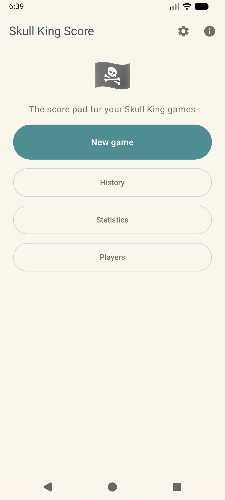
  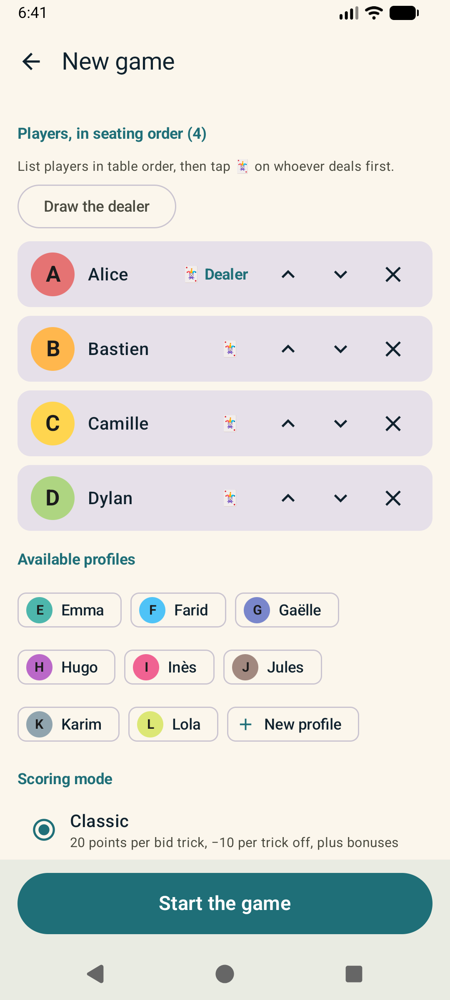
  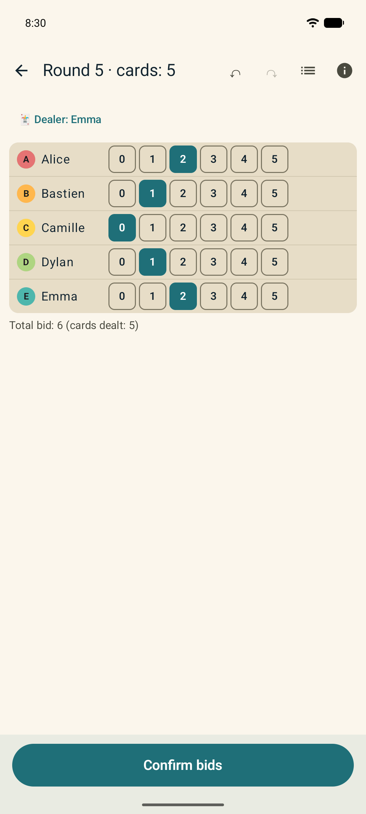
  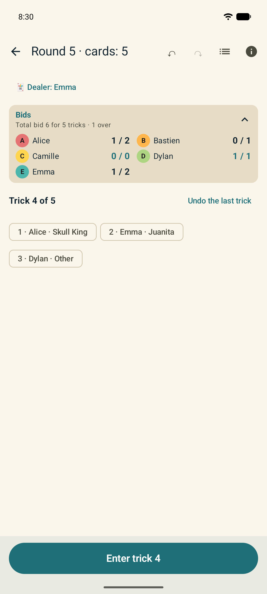
  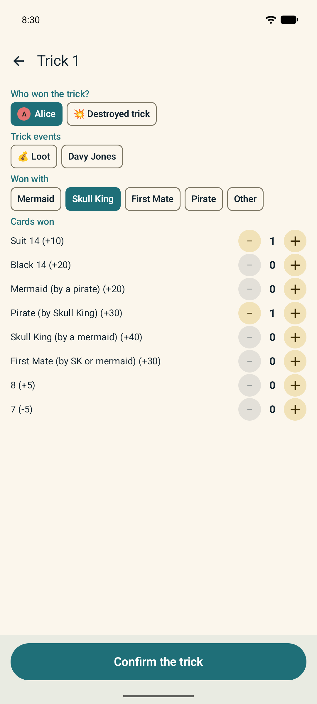
</p>

## Download

- **GitHub**: the signed APK of every version is attached to the [releases](https://github.com/Gamso/skullking_score/releases/latest)
- **F-Droid**: submission in progress

Android 8.0 or later. The interface is in English, French, German, Spanish, Italian and Portuguese, and follows the
language of the phone.

## How a game goes

One phone stays on the table, held by the "scribe".

1. **New game**: pick the players in seating order, draw or choose the first dealer, the scoring mode and the
   expansion cards in play
2. **Bids**: each player's bid, with one tap per player
3. **Tricks**: for each trick, its winner, the winning card and the captured bonus cards; Loots and Davy Jones'
   Locker are attached to the trick they were played in
4. **Scoreboard**: the points are computed as soon as the round is confirmed, and the dealer moves on to the next
   player
5. **Podium**: at the end of the game, the ranking, the score curve and images to share with the table

A mistake? Undo the last trick, or correct any past round: the whole game is recomputed.

## Features

**Rules**

- Base game: White Whale, Kraken, Loots, Tigress, every pirate
- **2026 expansion**, card by card: First Mate, Mary Thorne, 7 / 8 / 0-14, Wild 15, Spotted Ray, Davy Jones' Locker,
  Walk the Plank, Last Salvo
- Scoring modes: classic, Rascal, and Rascal + Cannonball (15 x N points)
- 2 to 8 players (9 with the expansion), flexible rounds (editable number of cards, extra rounds)

**During the game**

- Trick-by-trick entry (winner, card, captured cards) that fills in the results, with undo / redo
- Live events (Loot, Davy Jones' Locker) attached to the trick, cancellable log
- Non-blocking consistency warnings (more tricks than cards, a card entered twice…)
- Dealer tracking: the table order is the list order, and the dealer moves on every round
- Scoreboard as a ranking, a table (tap a cell to see the calculation) and a score curve
- Keeps the screen on while a game is in progress

**After the game**

- History with search and filters, expandable cards
- Statistics per player and scoring mode: records, trend chart, bid success by round size, favorite card,
  head-to-head between two players, filters by number of players, expansion and players present
- Card statistics: tricks won by card and pirate, bid success when a card wins, when cards win in a round, captured
  bonuses, Rascal wagers and Harry adjustments, Loots, Davy Jones' Locker, Kraken, expansion versus base game
- Sharing as images: podium, scoreboard, score curve, highlights, and per-player statistics

**Your data**

- Backup: JSON / CSV export, import with merge of same-name profiles, optional automatic backup to a folder
- Player profiles that can be renamed or archived

**Everywhere**

- Light / dark theme, tablet and landscape layouts, TalkBack support
- Built-in help with search: card hierarchy, scoring, expansion and FAQ, aligned with the official rules

<p align="center">
  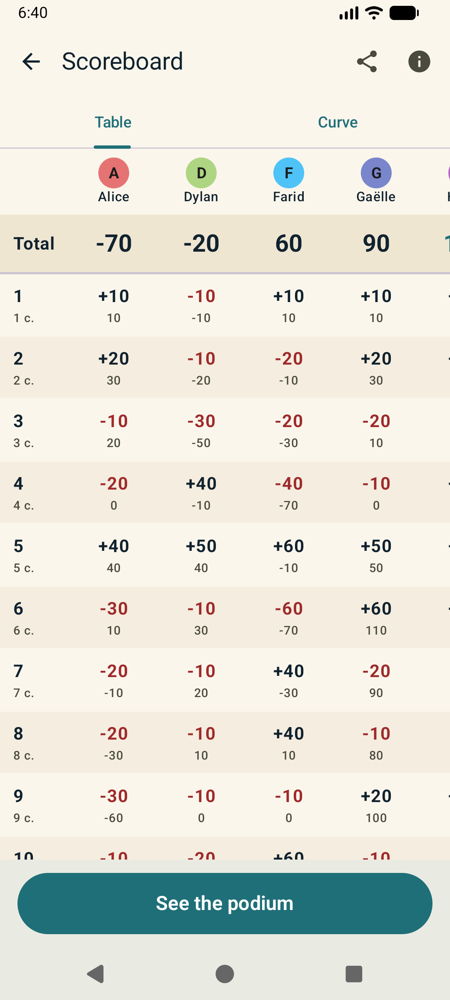
  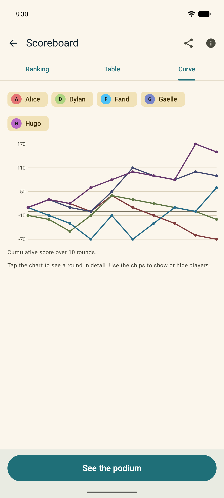
  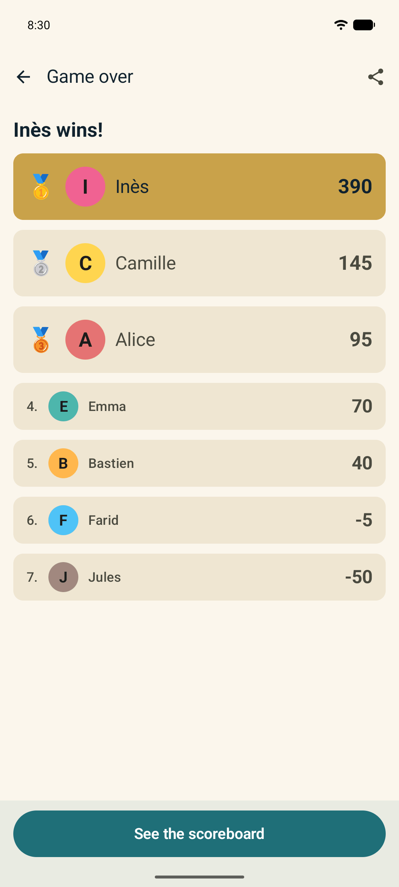
  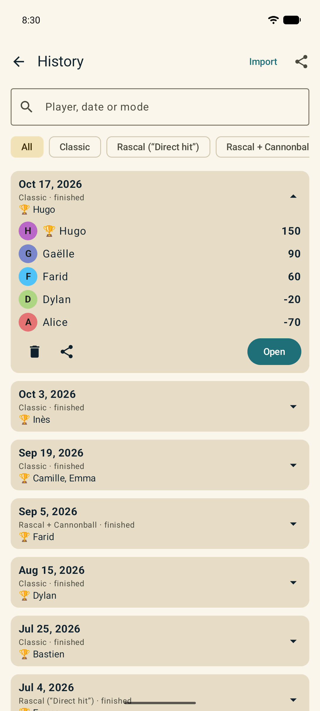
  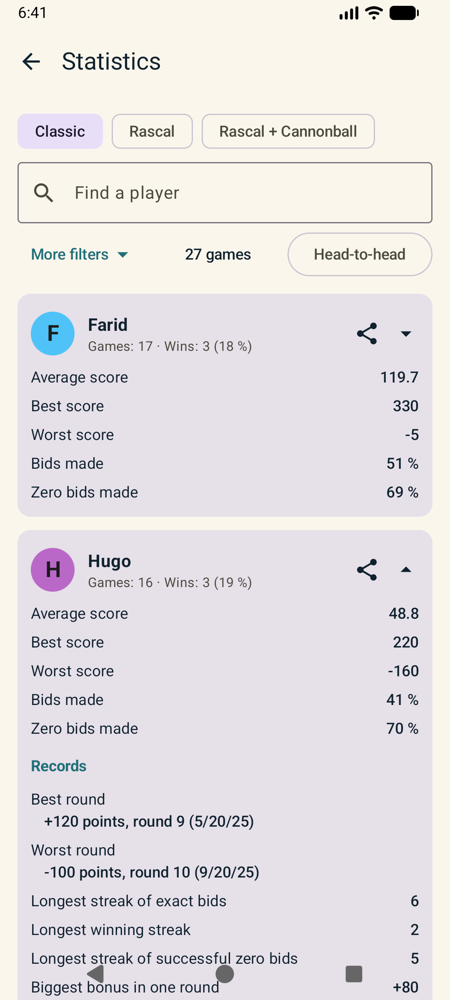
</p>

<p align="center">
  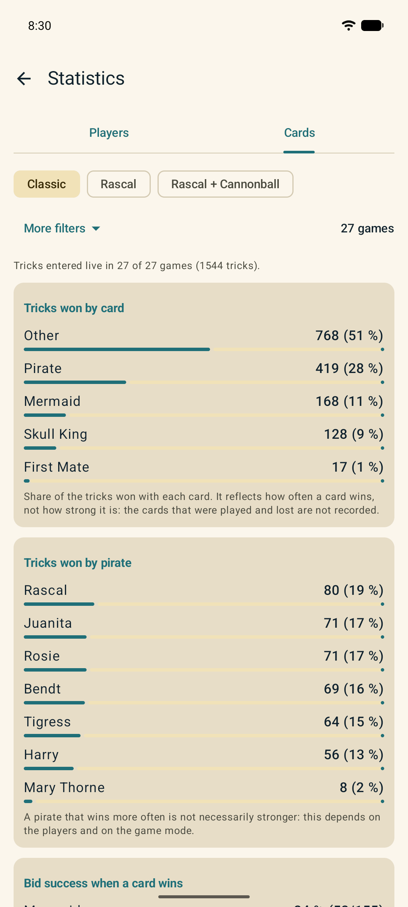
  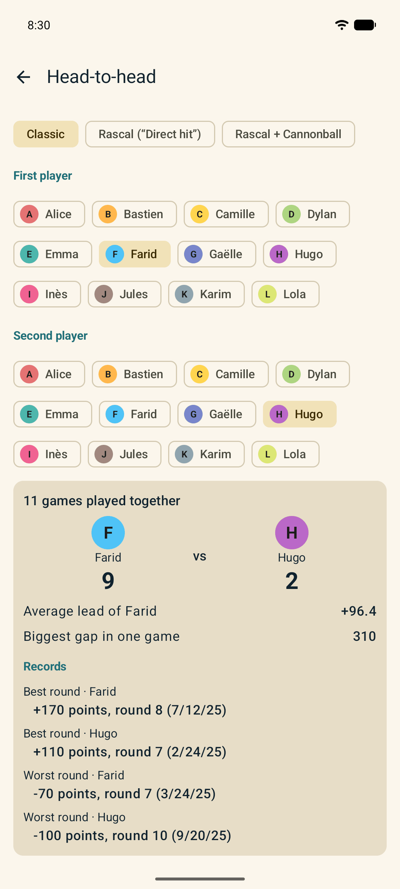
  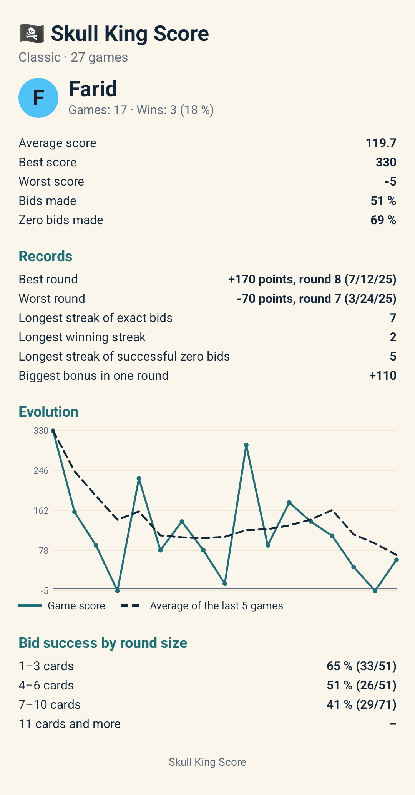
  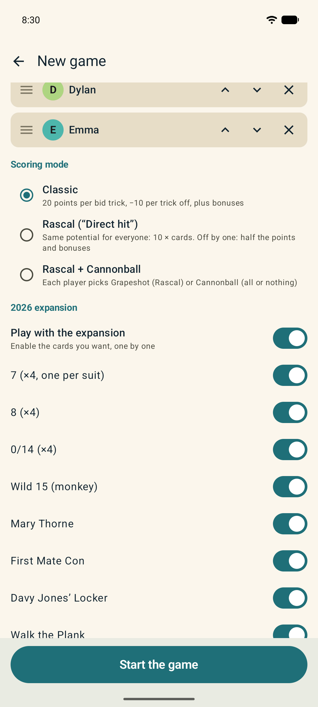
  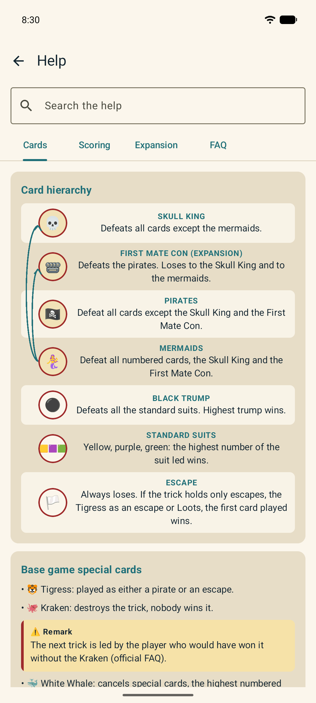
</p>

## Feedback

A wrong score, a crash, a broken screen?
[Open an issue](https://github.com/Gamso/skullking_score/issues/new?template=bug.md): for a score, give the rule and
the expected calculation. A JSON export of the game (**History → Export**) helps a lot.

Translations and fixes are welcome as pull requests; the checks to run are listed in the pull request template.

## Architecture

| Module         | Role                                                                                           |
| -------------- | ---------------------------------------------------------------------------------------------- |
| `core-scoring` | Rules, modes, `RoundScorer`, validation. Pure Kotlin, no Android dependency, tested with JUnit |
| `app`          | Compose application, organized in `domain` / `data` / `ui` layers                              |

Inside `app`:

- `domain`: models, repository interfaces, use cases, game scoring, statistics, undo history, CSV export
- `data`: Room 3 (entities, DAOs), repositories, JSON backup, automatic backup, settings
- `ui`: Jetpack Compose screens (Material 3) with their ViewModels, Compose navigation, image rendering for sharing
- `di`: Hilt modules

The score is never typed in: it is recomputed from the entries (bid, tricks, captured cards, events) and cached for
display. Correcting a past round recomputes the whole game.

Stack: Kotlin 2.4, Jetpack Compose, Hilt, Room 3, kotlinx.serialization. `minSdk` 26.

## Build

Requirements: JDK 17 or later (Android Studio's JBR works) and the Android SDK (`compileSdk` 37).

```bash
./gradlew :app:assembleDebug      # debug APK: app/build/outputs/apk/debug/
./gradlew :app:installDebug       # install on a device or an emulator
```

The release build (`:app:assembleRelease`) is signed only when the keystore is provided through the `SIGNING_*`
environment variables (see [`release.yml`](.github/workflows/release.yml)); otherwise it produces an unsigned APK.

## Quality

```bash
./gradlew ktlintCheck             # code style (Ktlint); ktlintFormat fixes it automatically
./gradlew detekt                  # static analysis (Detekt), configured in config/detekt/detekt.yml
./gradlew :app:lintDebug          # Android Lint
./gradlew :core-scoring:test :app:testDebugUnitTest

# Instrumented tests (emulator or connected phone): data layer, import / export, end-to-end flows
./gradlew :app:connectedDebugAndroidTest
```

Style rules live in [`.editorconfig`](.editorconfig). Detekt 2 is used in its alpha version, the only one compatible
with Kotlin 2.4 at the moment.

### Code coverage

JaCoCo reports are generated for the unit tests and for the instrumented tests:

```bash
./gradlew :core-scoring:jacocoTestReport                 # core-scoring/build/reports/jacoco/test/
./gradlew :app:createDebugUnitTestCoverageReport         # app/build/reports/coverage/test/debug/
./gradlew :app:createDebugAndroidTestCoverageReport      # needs an emulator or a phone
```

## Demo data

[`demo/skullking-demo.json`](demo/README.md) contains 12 players and 40 finished games (3 to 8 players, with or
without the expansion, in the three modes). Import it from **History → Import**. The procedure and how to regenerate
it are described in [`demo/README.md`](demo/README.md). The screenshots above are taken with it.

## Continuous integration

| Workflow                                                           | Trigger         | Content                                                                         |
| ------------------------------------------------------------------ | --------------- | ------------------------------------------------------------------------------- |
| [`ci.yml`](.github/workflows/ci.yml)                               | push `main`, PR | Ktlint, Detekt, Android Lint, unit tests with coverage, instrumented tests (emulator, cached AVD), test reports as checks, then debug APK as an artifact |
| [`dependency-review.yml`](.github/workflows/dependency-review.yml) | PR              | Flags newly added dependencies that have known vulnerabilities                  |
| [`release.yml`](.github/workflows/release.yml)                     | tag `v*`        | Checks, release APK + AAB, GitHub release publication                          |

Third-party actions are pinned to a commit SHA; Dependabot keeps them up to date.
The instrumented-tests job can be turned off by setting the repository variable `SKIP_INSTRUMENTED_TESTS` to `true`.

## Releasing

1. Set the default `versionName` / `versionCode` in [`app/build.gradle.kts`](app/build.gradle.kts)
   (`versionCode = major * 10000 + minor * 100 + patch`): F-Droid builds without the CI properties and reads them
2. Add `fastlane/metadata/android/<locale>/changelogs/<versionCode>.txt` for every language (500 characters max)
3. Merge into `main`, then tag: `git tag vX.Y.Z && git push origin vX.Y.Z`

The [`release.yml`](.github/workflows/release.yml) workflow publishes the GitHub release; F-Droid picks up the new tag
on its own.

## F-Droid

The store listing lives in [`fastlane/metadata/android`](fastlane/metadata/android); the submission recipe is in
[`docs/fdroid`](docs/fdroid/README.md).

## License and disclaimer

[MIT](LICENSE).

Skull King Score is an unofficial, fan-made app, not affiliated with or endorsed by Grandpa Beck's Games, publisher of
Skull King. You need the card game to play.
